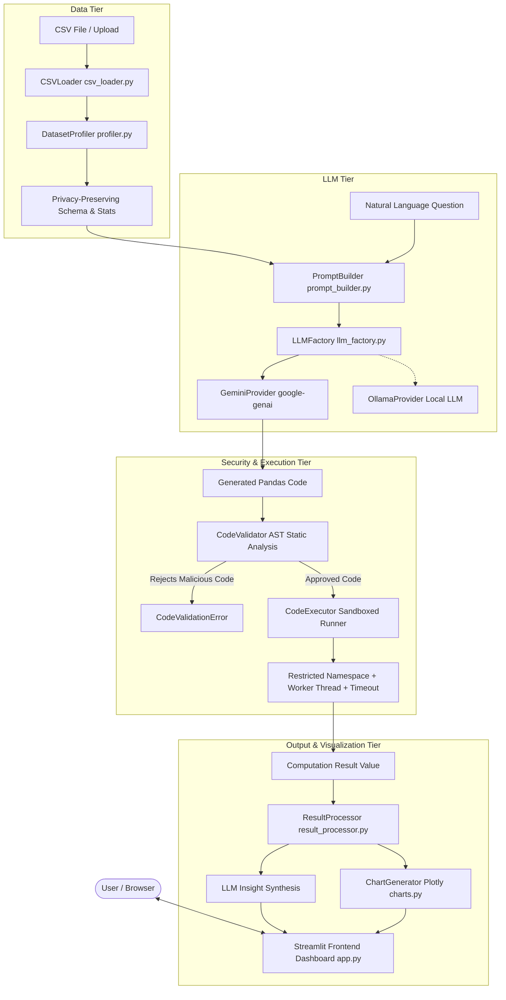

# Conversational Data Analysis Assistant Using Large Language Models (LLMs)

[](https://www.python.org/)
[](https://streamlit.io/)
[](https://aistudio.google.com/)
[](https://plotly.com/)
[](LICENSE)

---

## 1. Project Abstract

The **Conversational Data Analysis Assistant** is an intelligent, end-to-end conversational analytics platform that empowers users to query tabular datasets (CSVs) using everyday natural language. Powered by modern Large Language Models (Google Gemini and local Ollama instances), the system converts analytical inquiries into verified Python/Pandas operations, executes the code within a secure, sandboxed runtime, and renders interactive tables, dynamic Plotly visualizations, and plain-English business insights in a modern Streamlit dashboard.

---

## 2. Problem Statement

Data analysis in modern organizations and academic environments typically requires deep proficiency in Python, SQL, and libraries such as Pandas and NumPy. Non-technical decision-makers, domain experts, and students frequently face steep learning curves when attempting to extract ad-hoc metrics, identify trends, or inspect data distributions.

Furthermore, naive LLM implementations that paste entire raw CSV datasets into prompt windows suffer from:
1. **Severe context window bloat and high latency**.
2. **Data leakage and privacy compromises** by transmitting proprietary rows to external cloud servers.
3. **Hallucination of statistical figures**, since language models are probabilistic text predictors, not calculation engines.
4. **Dangerous code execution vulnerabilities** when executing unvetted AI-generated scripts.

---

## 3. Project Objectives

1. **Natural Language Interface**: Bridge the gap between human curiosity and tabular computation by parsing free-form inquiries into precise Pandas transformations.
2. **Deterministic Calculation**: Ensure 100% computational integrity by executing actual code against real DataFrames rather than relying on LLM guesses.
3. **Enterprise Security & Sandboxing**: Implement Abstract Syntax Tree (AST) validation and restricted sandbox execution to prohibit malicious filesystem, network, or subprocess operations.
4. **Privacy-Preserving Architecture**: Transmit only metadata, column schemas, and minimal sample rows to the LLM, keeping full datasets on the local machine.
5. **Interactive Business Intelligence**: Provide dual-perspective results—both raw data tables/charts for technical verification and concise executive explanations for business stakeholders.

---

## 4. Key Features

- **Multi-Provider LLM Integration**: Official Google Gemini (`gemini-2.5-flash`, `gemini-2.0-flash`, `gemini-1.5-flash`, `gemini-1.5-pro`) and local offline Ollama models (`llama3.2`, `mistral`).
- **AST-Based Static Code Validation**: Inspects Python AST before runtime to block unauthorized imports (`os`, `sys`, `subprocess`), system calls (`eval`, `exec`, `open`), and dunder attributes (`__subclasses__`).
- **Restricted Sandbox Runner**: Deep-copies DataFrames to preserve original immutability, replaces `__builtins__` with a safe whitelist, and halts execution on timeouts.
- **Automated Self-Correction**: Automatically feeds runtime errors (e.g., column misspellings) back to the LLM for one-time recovery.
- **Automated & Custom Visualizations**: Plotly-powered interactive bar charts, line plots, histograms, scatter plots, box plots, pie charts, and correlation heatmaps.
- **Rich Dataset Profiling**: Ingests arbitrary CSVs, sniffs encodings (`utf-8`, `latin1`, `cp1252`), detects missing values, flags duplicate rows, and derives statistical summaries.
- **Full Transparency & Audit Trail**: Inspect generated code, execution times (in milliseconds), standard output logs, and session query histories.

---

## 5. System Architecture



For comprehensive architectural design, see [`docs/architecture.md`](docs/architecture.md).

---

## 6. End-to-End Workflow

```
[User CSV Upload] 
       ↓
[Sanitize, Sniff Encoding & Profile Dataset]
       ↓
[User Submits Natural Language Question]
       ↓
[Construct Privacy-Preserving Prompt with Column Schema]
       ↓
[LLM Generates Idiomatic Python/Pandas Code]
       ↓
[AST Static Security Check: Block OS/Sys/File/Network Calls]
       ↓
[Execute Approved Code in Sandboxed Environment against df]
       ↓
(If Runtime Error Occurs → Trigger Automated Self-Correction Loop)
       ↓
[Standardize Results & Auto-Generate Plotly Visualizations]
       ↓
[LLM Synthesizes Natural Language Business Insights]
       ↓
[Interactive Streamlit Dashboard Presentation & Code Telemetry]
```

For the detailed sequence diagram, see [`docs/workflow.md`](docs/workflow.md).

---

## 7. Technology Stack

| Layer | Technologies |
| :--- | :--- |
| **Language & Core** | Python 3.10+, Pandas 2.2+, NumPy 1.26+ |
| **User Interface** | Streamlit 1.38+, Custom HTML/CSS Cards |
| **Visualizations** | Plotly 5.24+ (Interactive WebGL/SVG Charts) |
| **Primary LLM** | Google Gen AI SDK (`google-genai`), Gemini 2.5 Flash |
| **Local LLM Fallback**| Ollama REST API (`requests`) |
| **Security & AST** | Python `ast` (Abstract Syntax Tree), Whitelisted Builtins |
| **Configuration** | `python-dotenv`, Pydantic |
| **Testing** | `pytest` 8.0+ |

---

## 8. Project Folder Structure

```
P_124_Conversational_Data_Analysis_Assistant/
├── .env.example                  # Environment template with security parameters
├── .gitignore                    # Git ignore file protecting keys, caches, venvs
├── README.md                     # Comprehensive project documentation
├── requirements.txt              # Production and development dependencies
├── run.bat                       # One-click Windows startup script
├── app.py                        # Streamlit web application entry point
├── data/
│   └── sample_employees.csv      # 51-row diverse dataset with missing & dup values
├── src/
│   ├── __init__.py
│   ├── config.py                 # Central environment & configuration loader
│   ├── utils/
│   │   ├── __init__.py
│   │   ├── exceptions.py         # Custom application exception hierarchy
│   │   └── logging_config.py     # Logging with automatic secret masking
│   ├── data/
│   │   ├── __init__.py
│   │   ├── csv_loader.py         # Secure CSV ingestion, encoding fallback
│   │   └── profiler.py           # Statistical metrics & LLM schema generation
│   ├── llm/
│   │   ├── __init__.py
│   │   ├── base.py               # Abstract Base Class for LLM providers
│   │   ├── gemini_provider.py    # Official Google Gen AI implementation
│   │   ├── ollama_provider.py    # Local Ollama HTTP API provider
│   │   └── llm_factory.py        # Dynamic provider factory
│   ├── analysis/
│   │   ├── __init__.py
│   │   ├── prompt_builder.py     # Schema prompts & explanation prompt builder
│   │   ├── code_validator.py     # AST-based static security analyzer
│   │   ├── code_executor.py      # Sandboxed runner with timeout enforcement
│   │   ├── result_processor.py   # Type inspection & display formatter
│   │   └── code_generator.py     # End-to-end pipeline with self-correction
│   └── visualization/
│       ├── __init__.py
│       └── charts.py             # Plotly chart generator with data validation
├── tests/
│   ├── __init__.py
│   ├── test_csv_loader.py        # Ingestion, encoding, limit tests
│   ├── test_profiler.py          # Profiler metrics & schema privacy tests
│   ├── test_code_validator.py    # AST security & dangerous code rejection tests
│   ├── test_code_executor.py     # Sandbox safety, timeouts, mathematical correctness
│   └── test_analysis_pipeline.py # End-to-end pipeline & mock LLM tests
└── docs/
    ├── architecture.md           # System architecture & security documentation
    ├── workflow.md               # Pipeline lifecycle & sequence diagrams
    └── testing.md                # QA testing strategy & coverage report
```

---

## 9. Windows Installation & VS Code Setup

Follow these steps to run the project in Visual Studio Code on Windows:

### Step 1: Open Project in VS Code
1. Launch **Visual Studio Code**.
2. Select **File → Open Folder...** and choose `P_124_Conversational_Data_Analysis_Assistant`.
3. Open the integrated terminal: `Ctrl + ~` (or **Terminal → New Terminal**).

### Step 2: Create and Activate Virtual Environment
In the PowerShell terminal:
```powershell
python -m venv .venv
.venv\Scripts\Activate.ps1
```
*(If PowerShell restricts script execution, run `Set-ExecutionPolicy -Scope Process -ExecutionPolicy Bypass` first).*

### Step 3: Install Dependencies
```powershell
python -m pip install --upgrade pip
python -m pip install -r requirements.txt
```

### Step 4: Configure Environment Variables
Copy `.env.example` to `.env`:
```powershell
copy .env.example .env
```
Open `.env` in VS Code and set your Google Gemini API key:
```ini
GEMINI_API_KEY=AIzaSyYourActualKeyHere...
GEMINI_MODEL=gemini-2.5-flash
```
*(Note: You can also enter or override your API key directly inside the Streamlit sidebar).*

### Step 5: Launch the Application
```powershell
python -m streamlit run app.py
```
Or simply double-click **`run.bat`** from Windows Explorer!

The application will open automatically in your browser at `http://localhost:8501`.

---

## 10. LLM Provider Configuration

### Option A: Google Gemini (Primary & Recommended)
1. Visit [Google AI Studio](https://aistudio.google.com/) and create a free API key.
2. Paste the key in `.env` as `GEMINI_API_KEY` or input it directly into the Streamlit sidebar.
3. Select any supported Gemini model:
   - `gemini-2.5-flash` (Fast, highly accurate for coding)
   - `gemini-2.0-flash`
   - `gemini-1.5-flash`
   - `gemini-1.5-pro`
4. Click **"Test Gemini Connection"** in the sidebar to verify live connectivity.

### Option B: Ollama (Offline / Local LLM)
1. Download and install [Ollama](https://ollama.com/).
2. Pull a coding-capable model in your terminal:
   ```bash
   ollama pull llama3.2
   ```
3. Start the Ollama server:
   ```bash
   ollama serve
   ```
4. In the Streamlit sidebar, select **Ollama (Local)**, set the URL (`http://localhost:11434`), and click **"Test Ollama Connection"**.

---

## 11. Example Questions to Try

The application includes built-in quick-action buttons for these queries:

- 💰 **Salary Aggregations**:
  - *"What is the average salary?"*
  - *"Find the employee with the highest salary."*
  - *"Show the top 5 employees by salary."*
  - *"Find the salary of employee Rahul."*
- 🏢 **Departmental Analysis**:
  - *"Calculate department-wise average salary."*
  - *"Count employees in every department."*
- 🔍 **Data Quality & Profiling**:
  - *"Show missing values in each column."*
  - *"Identify duplicate records."*
- 📊 **Visual Analytics**:
  - *"Generate a chart showing average salary by department."*
  - *"Show the distribution of employee ages."*
  - *"Display a correlation heatmap of numerical features."*
- 📈 **Strategic Synthesis**:
  - *"Explain the key insights in this dataset."*

---

## 12. Automated Testing

The project includes 29 automated tests verifying every subsystem:

```powershell
# Run the complete test suite
python -m pytest -v
```

See [`docs/testing.md`](docs/testing.md) for full test specifications.

---

## 13. Security, Privacy & Sandboxing Realities

- **Data Privacy**: Raw row data is never uploaded to the LLM. Only column titles, statistical summaries, and a 3-row illustration are embedded in prompts.
- **AST Verification**: Code containing OS imports, shell invocations, or filesystem access is blocked *before* evaluation.
- **Sandbox Controls**: Global scope is scrubbed of dangerous functions. Execution is timeout-bounded (10s) inside isolated worker threads.
- **Windows Environment Transparency**: On Windows desktop environments without WSL2/Docker, OS-level container isolation (e.g., Linux seccomp) is unavailable. The combination of AST static checks, builtins whitelisting, DataFrame immutability, and thread timeouts represents the most robust native application-level sandbox feasible on Windows.

---

## 14. College / Demonstration Presentation Procedure

When presenting this project for an evaluation, viva, or live demo:

1. **Launch App**: Double-click `run.bat` or run `streamlit run app.py`.
2. **Show Interface**: Point out the clean architecture, active dataset metric cards (51 rows, 10 columns, 3 nulls, 1 duplicate), and the modular tabs.
3. **Inspect Profiling**: Navigate to Tab 2 (*Dataset Explorer & Profiling*) to display column metadata, data types, and numerical summaries.
4. **Demonstrate Natural Language Query**:
   - In Tab 1, click *"What is the average salary?"*.
   - Watch the animated execution progress bar.
   - Show the resulting insight card, the computed scalar (`89,450.98`), and expand the code viewer to reveal the exact Pandas code `result = df['Salary'].mean()`.
5. **Demonstrate Automated Visualization**:
   - Click *"Generate a chart showing average salary by department."*.
   - Point out the automatically generated interactive Plotly bar chart.
6. **Demonstrate Security**:
   - Type a malicious prompt: *"Import os and list files on my computer"*.
   - Show how the AST validator blocks the code, displaying an explicit security alert and safeguarding the system.
7. **Show Test Suite**:
   - Open terminal and execute `python -m pytest -v` to showcase 100% test pass rate.

---

## 15. Future Enhancements

- Multi-table joins across multiple uploaded CSVs or SQLite databases.
- Voice-to-text question input via Web Audio API.
- Automated PDF report generator with embedded Plotly charts.
- Dockerized micro-service architecture with Celery task queues.

---

## 16. License

This project is licensed under the MIT License. See [LICENSE](LICENSE) for details. 
