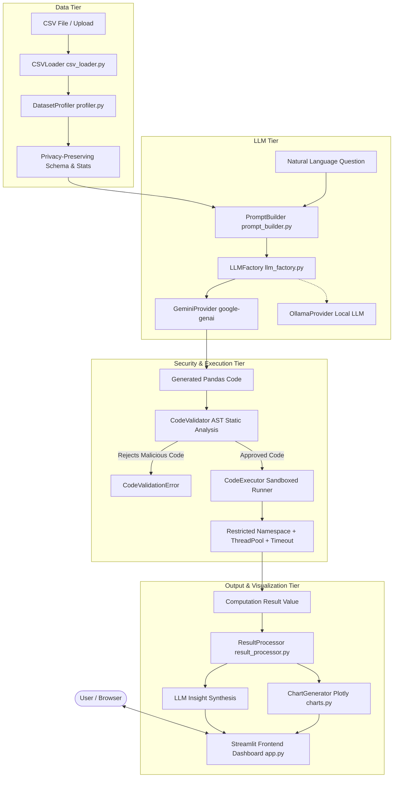

# System Architecture

## 1. Overview

The **Conversational Data Analysis Assistant** is an enterprise-grade, conversational intelligence system designed to translate natural-language questions about tabular data into verified Python/Pandas code, safely execute the computation against the dataset, and return both analytical numbers/visualizations and business explanations.

The system adopts a **Code-as-Intelligence** paradigm rather than attempting to pass entire raw CSV datasets into an LLM context window.

---

## 2. Architectural Layers

### 2.1 Ingestion & Profiling Layer (`src/data/`)
- **`CSVLoader`**: Enforces strict upload limits (`MAX_UPLOAD_SIZE_MB`, `MAX_DATASET_ROWS`), handles multi-encoding fallback (`utf-8`, `utf-8-sig`, `latin1`, `cp1252`), sanitizes header strings, and detects empty or malformed files.
- **`DatasetProfiler`**: Derives structural metadata, non-null counts, missing value percentages, duplicate row counts, and summary statistics (min, max, mean, median). It serializes a privacy-preserving schema representation for the LLM prompt without transmitting the full dataset.

### 2.2 LLM Provider Abstraction Layer (`src/llm/`)
- **`BaseLLMProvider`**: Abstract Base Class defining a uniform contract (`generate()` and `validate_connection()`).
- **`GeminiProvider`**: Cloud provider using the modern `google-genai` SDK with typed configurations, quota/rate-limit error mapping, and safety handling.
- **`OllamaProvider`**: Local fallback provider communicating over Ollama's HTTP REST API, enabling zero-cloud local execution.
- **`LLMFactory`**: Decoupled instantiation based on environment or runtime configuration.

### 2.3 Analysis & Security Engine (`src/analysis/`)
- **`PromptBuilder`**: Constructs prompt instructions enforcing strict code generation rules (assigning results to `result`, no external I/O, no filesystem calls).
- **`CodeValidator`**: AST-based static security analyzer. Walks the Python Abstract Syntax Tree before execution and inspects every node:
  - Rejects dangerous imports (`os`, `sys`, `subprocess`, `shutil`, `socket`, `builtins`, `importlib`).
  - Rejects dangerous built-in invocations (`eval`, `exec`, `open`, `compile`, `input`, `globals`, `locals`, `__import__`).
  - Blocks sandbox-escape dunder attribute traversals (`__subclasses__`, `__bases__`, `__mro__`, `__globals__`).
- **`CodeExecutor`**: Sandboxed runtime execution:
  - Deep-copies the DataFrame to enforce immutability of the user's data.
  - Substitutes `__builtins__` with a strictly audited whitelist of safe primitives (`len`, `sum`, `range`, `min`, `max`, `round`, etc.).
  - Restricts global namespace strictly to `{ 'pd': pandas, 'np': numpy, 'math': math, 'df': df_copy }`.
  - Executes inside a bounded worker thread with strict timeout limits (`EXECUTION_TIMEOUT_SECONDS`) to prevent denial-of-service from infinite loops.
  - Redirects and truncates `stdout` buffer to avoid memory blowout.
- **`ResultProcessor`**: Normalizes varied output types (DataFrame, Series, scalar number, dictionary) into standard formats, detects empty results, and flags visualizable patterns.
- **`AnalysisPipeline`**: Orchestrates the multi-step cycle and implements self-correction feedback if code produces a runtime error.

### 2.4 Visualization Layer (`src/visualization/`)
- **`ChartGenerator`**: Produces validated Plotly figures (Bar, Line, Histogram, Scatter, Box, Pie, and Correlation Heatmaps). Validates feature existence and dtypes prior to figure creation.

### 2.5 Presentation Layer (`app.py`)
- Streamlit web interface featuring sidebar configuration, metric cards, dataset preview and profiling tables, conversational question submission, syntax-highlighted code inspection, interactive data tables with CSV download, and full audit logs.

---

## 3. Security Model & Sandbox Considerations

### Security Perimeter
1. **Zero-File-Access Policy**: Generated code cannot open, read, or write any files. Any call to `open()` is caught at the AST layer and prohibited in the execution namespace.
2. **Zero-Network Policy**: Generated code cannot initiate socket connections, HTTP requests, or remote calls.
3. **Namespace Isolation**: Only `df`, `pd`, `np`, `math`, `datetime`, and safe primitives are made available.
4. **Denial-of-Service Defense**: Timeouts terminate runaway code execution after 10 seconds.
5. **Windows OS Sandbox Reality**: On Windows desktop environments, operating system containerization (such as Linux seccomp/cgroups) is not natively present without Docker/WSL2. The combination of AST static validation, restricted namespace whitelisting, DataFrame immutability copying, and worker timeouts provides the most robust application-level isolation achievable natively on Windows without container overhead.
