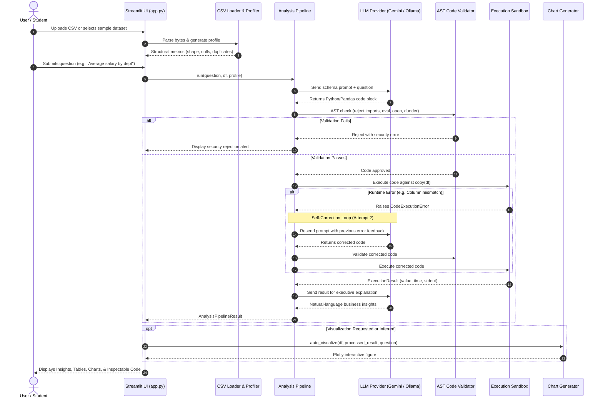

# End-to-End Workflow & Pipeline Execution

This document details the step-by-step lifecycle of an analytical question from user submission to visual and explanatory output.



---

## Workflow Stages Explained

### 1. Data Ingestion & Sanitation
1. The user uploads a CSV or loads `sample_employees.csv`.
2. `CSVLoader` inspects file size, detects encoding (trying UTF-8, Latin-1, CP1252), strips whitespace from column headers, and validates that rows exist.
3. `DatasetProfiler` computes non-null rates, duplicates, data types, and min/max/mean/median.

### 2. Privacy-Preserving Schema Extraction
Rather than uploading the entire dataset to external cloud APIs:
- Only column names, inferenced data types, null ratios, and 3 representative sample rows are formatted into context.
- The user's actual confidential rows remain strictly on the local machine.

### 3. Prompt Construction & Code Generation
- `PromptBuilder` instructs the LLM that the DataFrame is already present in variable `df`.
- The LLM generates idiomatic pandas code assigning the final output to variable `result`.
- Enforces code fencing (` ```python ... ``` `).

### 4. Static AST Security Validation
- Python's standard `ast` library builds a syntax tree of the untrusted code.
- Nodes are checked against a strict whitelist of modules and operations.
- Any attempt to import unauthorized modules (`os`, `sys`, `subprocess`, `requests`), call forbidden built-ins (`eval`, `open`), or inspect dunder attributes (`__subclasses__`) is immediately blocked without running the code.

### 5. Sandboxed Execution
- The DataFrame is deep-copied to prevent state pollution or column dropping.
- Globals are locked down; `__builtins__` is restricted to safe functional primitives.
- Code is executed within a thread-worker with an `EXECUTION_TIMEOUT_SECONDS` (default: 10s) safeguard.

### 6. Automated Self-Correction Loop
- If the first code attempt encounters an unexpected KeyError (e.g. column naming discrepancy) or ValueError:
  - The pipeline catches the exception.
  - An updated prompt is formed containing the exact error traceback.
  - The LLM is given an opportunity to self-correct and produce amended code.

### 7. Result Processing & Business Explanation
- The computed `result` is formatted by `ResultProcessor` into tabular, scalar, or categorical structures.
- A secondary LLM call synthesizes an executive summary explaining key findings in clear, conversational English.

### 8. Interactive Presentation
- Results are displayed across modular Streamlit tabs.
- Interactive Plotly charts are generated automatically when analytical patterns (comparisons, distributions, trends) are detected.
- Code is made transparent in an expandable disclosure widget for auditability.
